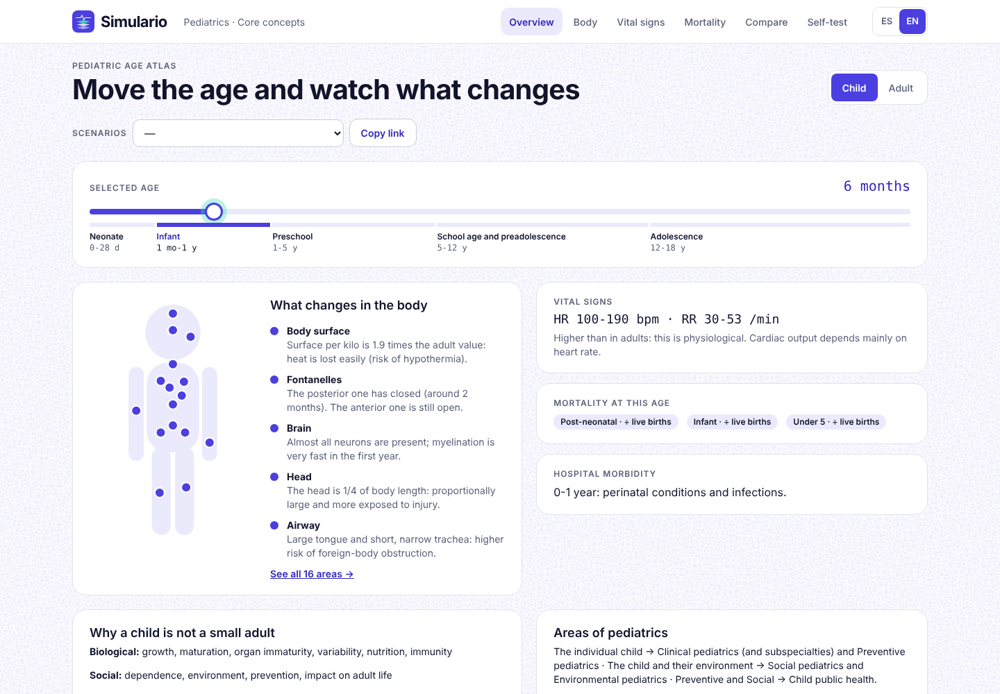

# Pediatric age atlas · Atlas de la edad pediátrica

An interactive atlas of the pediatric age for medical students and teachers. Move one age slider (birth → 18 years) and see what changes: the period of childhood, 16 body traits, normal vital signs, blood and tidal volumes, body composition, the child mortality indicators that apply at that age, and hospital morbidity. A mortality lab draws every rate on a timeline with its window and denominator, a compare mode puts two ages side by side, and a self-test is generated from the same data.

**Live demo:** https://ferasmed-dev.github.io/pediatric-age-atlas/ · English: https://ferasmed-dev.github.io/pediatric-age-atlas/?lang=en



Spanish (Castilian) by default, English with the ES/EN switch or `?lang=en`.

> Teaching tool · not for clinical use.

## What it shows

| View | What the student does |
|---|---|
| **Vista general / Overview** | One age slider over the five periods. The body figure changes proportions with age (head 1/4 → 1/8 of body length, legs 3/8 → 1/2). Cards show the normal vital-sign ranges, which mortality rates cover that age and the hospital morbidity group. A **Child / Adult** toggle swaps everything to adult values. |
| **Cuerpo / Body** | 16 traits (body surface, fontanelles, brain, head, airway, metabolism, ribs, heart, breathing, diaphragm, abdomen, kidney, body water, blood volume, bones, muscle). Pick one on the figure or in the list: what happens at this age, when it changes (a bar over the age axis), and the adult value. A body-composition chart plots total water, extracellular water and muscle (% of body weight) with a table view. |
| **Constantes / Vital signs** | Age and weight sliders. Child vs adult table: HR and RR ranges with gauges, cardiac output, blood volume, tidal volume, muscle, body water, kidney, diaphragm. "Try a value" sliders classify a measured HR/RR as below, within or above the range for age. Unusual weight-for-age is flagged. |
| **Mortalidad / Mortality** | Enter counts (or load a fictional cohort) and get nine rates per 1000. Each rate is a bracket on the timeline (gestation → birth → 7 d → 28 d → 1 y → 5 y → 15 y); the selected one shows numerator and denominator, and two gauges compare neonatal and under-5 mortality with the SDG 3.2 targets. The late-fetal-death threshold can be set to 22 weeks (WHO) or 28 weeks (INE). |
| **Comparar / Compare** | Two age sliders; 21 rows (period, HR, RR, the 16 traits, mortality window, morbidity) with the rows that differ highlighted. |
| **Autotest / Self-test** | 12 questions per round covering periods, body, vital signs, mortality and morbidity. Answering moves the atlas to that age or rate; "See it in the atlas" opens it. Score per block. |

## Curriculum fit

For students and teachers at any Spanish medical faculty. The content belongs to the common curriculum set by Orden ECI/332/2008:

- **Módulo III · Formación clínica humana** → *Pediatría* (introduction to the pediatric age, periods, physiological differences of the child, vital signs).
- **Módulo II · Medicina social, habilidades de comunicación e iniciación a la investigación** → *Medicina Preventiva y Salud Pública / Epidemiología* (mortality indicators, perinatal and child health, SDG 3.2).
- Supports *Fisiología* (body water, blood volume, ventilation by age).

**MIR relevance:** yes. Definitions and denominators of perinatal, neonatal and infant mortality, normal pediatric vital signs and fontanelle timing are recurring exam topics in Pediatría and Medicina Preventiva.

## For teachers

Every scenario has a deep link; add `&lang=en` for English.

| Link | Opens |
|---|---|
| `?preset=recien-nacido` | Overview at 3 days |
| `?preset=lactante-6m` | Vital signs, 6 months, 7.6 kg |
| `?preset=fontanelas-14m` | Body view, fontanelles at 14 months |
| `?preset=preescolar-3a` | Overview at 3 years |
| `?preset=escolar-8a` | Vital signs, 8 years, 26 kg |
| `?preset=adolescente-15a` | Overview at 15 years |
| `?preset=comparar-3m-10a` | Compare 3 months and 10 years |
| `?preset=mortalidad-cumple-ods` | Mortality, cohort meeting SDG 3.2, infant mortality selected |
| `?preset=mortalidad-no-cumple-ods` | Mortality, cohort missing SDG 3.2, neonatal mortality selected |
| `?preset=autotest` | A fresh self-test round |

Any view also opens with `?view=overview|body|vitals|mortality|compare|quiz`. The **Copy link** button copies the current scenario.

## Model

All logic is in `src/model.js` as pure functions (ages in days; 1 year = 365.25 d).

**Mortality rates (per 1000)**

| Rate | Numerator | Denominator |
|---|---|---|
| Late fetal | late fetal deaths | live births + late fetal deaths |
| Perinatal | late fetal deaths + deaths 0-6 d | live births + late fetal deaths |
| Early neonatal | deaths 0-6 d | live births |
| Late neonatal | deaths 7-27 d | live births |
| Neonatal | deaths < 28 d | live births |
| Post-neonatal | deaths 28 d-1 y | live births |
| Infant | deaths < 1 y | live births |
| Under-5 | deaths < 5 y | live births (approximation; WHO uses a life-table probability) |
| 5-14 years | deaths 5-14 y | population aged 5-14 |

SDG 3.2 targets for 2030: neonatal ≤ 12 and under-5 ≤ 25 per 1000 live births.

**Parameters and their basis**

| Parameter | Value | Basis |
|---|---|---|
| Periods | neonate 0-28 d · infant 28 d-1 y · preschool 1-5 y · school 5-12 y · adolescence 12-18 y | Common Spanish scheme; some texts extend infancy to 24 months (noted in the app) |
| HR, awake (bpm) | < 28 d 100-205 · < 1 y 100-190 · 1-2 y 98-140 · 3-5 y 80-120 · 6-11 y 75-118 · ≥ 12 y 60-100 | PALS table (Fleming et al. 2011) |
| RR (/min) | < 1 y 30-53 · 1-2 y 22-37 · 3-5 y 20-28 · 6-11 y 18-25 · ≥ 12 y 12-20 | PALS table (Fleming et al. 2011) |
| Adult HR / RR | 60-100 / 12-20 | Physiology |
| Blood volume | 85 mL/kg (neonate) · 80 (infant) · 75 (child) · 70 (adolescent, adult) | Pediatric reference texts |
| Tidal volume | 6-8 mL/kg at every age | Respiratory physiology |
| Total / extracellular water | 75 / 45 % at birth → 60 / 26 % at 1 y → 60 / 20 % adult | Friis-Hansen; **Model**: linear between points |
| Muscle | 25 % of body weight in the infant → 40 % in the adult | Physiology; **Model**: linear after 1 y |
| Head length | 1/4 of body length at birth → 1/8 in the adult | Proportions of growth; **Model**: piecewise linear |
| Resting O2 consumption | ≈ 7 → 3.5 mL/kg/min | Physiology; **Model**: piecewise linear |
| Fontanelles | posterior closes ≈ 2 months; anterior closes 12-18 months | Pediatric textbooks |
| Kidney concentrating ability | matures between 12 and 18 months | Pediatric physiology |
| Diaphragm as main breathing muscle | until 4-5 years | Pediatric physiology |
| Typical weight/height by age | WHO 0-5 y and WHO 2007 / CDC medians, sexes averaged | **Model**: used only for defaults, plausibility and body-surface ratio |
| Body surface | Mosteller formula, per kg, relative to a 70 kg / 170 cm adult | ≈ 2.5× at birth |

**Known simplifications**

- Trait changes are shown as step changes at the usual ages; real children vary.
- Vital-sign ranges are for awake, resting children; other guides (APLS, ERC) use slightly different cut-offs.
- Body composition and head proportion are interpolated between published reference points.
- Morbidity groups (0-1 y, 1-14 y) are qualitative.
- Mortality cohorts are fictional teaching data, not real statistics.

## Presets and expected results

| Preset | Expected |
|---|---|
| `lactante-6m` | HR 100-190, RR 30-53, blood volume 608 mL (80 × 7.6), tidal volume 46-61 mL |
| `escolar-8a` | HR 75-118, RR 18-25, blood volume 1 950 mL (75 × 26), tidal volume 156-208 mL |
| `recien-nacido` | HR 100-205, RR 30-53, body surface per kg ≈ 2.5× the adult |
| `comparar-3m-10a` | 16 of 21 rows change |
| `mortalidad-cumple-ods` | neonatal 2.20 ‰ (early 1.50, late 0.70), post-neonatal 1.00, infant 3.20, under-5 3.80, perinatal 4.49, late fetal 2.99, 5-14 y 0.10; both SDG targets met |
| `mortalidad-no-cumple-ods` | neonatal 24.0 ‰ (early 18.0, late 6.0), post-neonatal 16.0, infant 40.0, under-5 55.0, perinatal 37.3, late fetal 19.6, 5-14 y 0.45; both SDG targets missed |

## Layout

```
index.html
src/model.js      pure model: age scale, periods, traits, vitals, volumes, rates, compare, quiz
src/i18n.js       Spanish and English strings
src/ui.js         views, sliders, URL state (window.__sim for automated checks)
src/charts.js     SVG timeline and body-composition chart
src/styles.css
tests/model.test.js
docs/screenshot.png
curriculum.json   topic metadata
```

## Run locally

```
python3 -m http.server
# open http://localhost:8000/
```

No build step and no dependencies. Works offline once loaded.

## Tests

```
npm test   # node --test, Node 18+
```

The tests cover the age scale, period boundaries, vital ranges, volumes, body composition, every trait's change ages, all nine mortality rates and their denominators, SDG status, robustness to empty or invalid input, compare, presets and the quiz bank. GitHub Actions runs them on every push.

## Deploy

Push to a public repo named `pediatric-age-atlas`, then Settings → Pages → Deploy from a branch → `main` / `(root)`.

## References

- Fleming S, et al. Normal ranges of heart rate and respiratory rate in children from birth to 18 years of age: a systematic review of observational studies. *Lancet* 2011;377:1011-1018.
- American Heart Association. *Pediatric Advanced Life Support (PALS) Provider Manual*. Vital-sign reference table.
- World Health Organization. ICD-11 / ICD-10 definitions of the perinatal period (from 22 completed weeks of gestation) and of neonatal and infant mortality.
- Instituto Nacional de Estadística (INE). Indicadores de mortalidad infantil y perinatal (late fetal death from 28 weeks).
- United Nations. Sustainable Development Goal 3, target 3.2 (2030): neonatal mortality ≤ 12 and under-5 mortality ≤ 25 per 1000 live births. UN IGME methodology for the under-5 mortality rate.
- UN General Assembly. Convention on the Rights of the Child (1989), art. 1.
- Friis-Hansen B. Body water compartments in children: changes during growth and related changes in body composition. *Pediatrics* 1961;28:169-181.
- Kliegman RM, et al. *Nelson Textbook of Pediatrics*. Growth, development and physiology of the newborn and child.
- Cruz M. *Tratado de Pediatría*. Concepto de pediatría y periodos de la edad pediátrica.
- WHO Child Growth Standards (0-5 y) and WHO 2007 growth reference (5-19 y).
- Mosteller RD. Simplified calculation of body-surface area. *N Engl J Med* 1987;317:1098.

## License

MIT © 2026 Feras Elhissi
